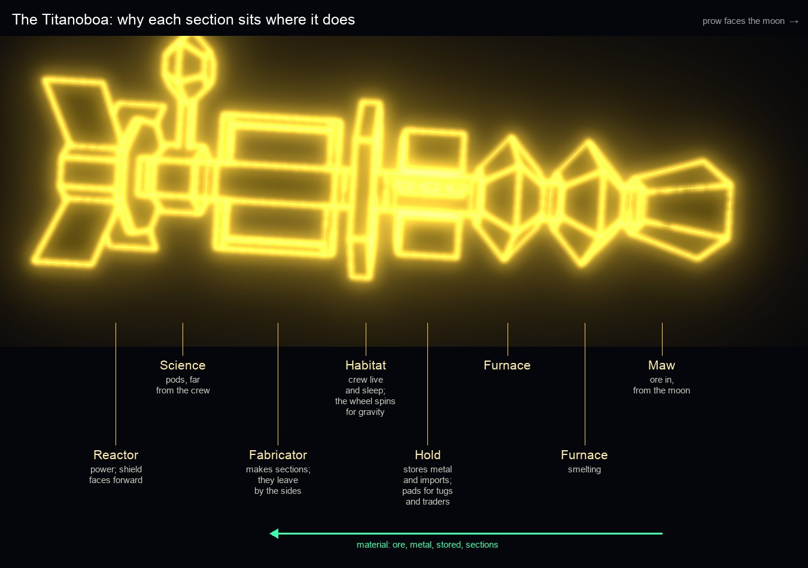

# Design: the Titanoboa, a modular factory

*Design, 25 October 2026, from Mark's idea: the Titan is a factory in space, built from sections that can be removed and replaced, so it can be as large as it needs to be. Stage 1 is built: the modular Titanoboa is the one in the game. Modern only, as yards are.*

## Why

The Titanoboa is Wexley-Yorozu's constructor: it arrives at a moon, eats it a little at a time, and leaves a station behind ([the trading companies](../companies.md#the-fleet-the-titanoboa-and-the-yards)). The current hull is a box spine covered in blocks, chimneys and windows, 264 lines that glow into one yellow smear at any distance. That breaks the rule we hold every ship to: **elegance over detail** ([ships and classes](ships-and-classes.md), [CONTRIBUTING](../../CONTRIBUTING.md)).

Mark's idea answers both problems. A factory in space wouldn't be one hull; it would be **sections on a common coupling**: a reactor, furnaces where the exotic materials are made, a fabricator, quarters for the workers, the drive. A section that fails is uncoupled and replaced. A bigger job gets more sections. So the ship is as large as it needs to be, and each section can be drawn as one clear shape, which is the elegance we want: you read it along its length, *maw, furnace, furnace, reactor, fabricator, habitat, drive*, at a glance.

## Principles

- **One shape per module.** Each section has a single silhouette that says what it does, in a handful of lines. No windows, pipes or panels.
- **One coupling.** Every module meets the next through the same short square coupling, so any module fits anywhere and the joins read as joins: you can see where it comes apart.
- **As big as the job.** A small refinery job is four modules; a station is seven; a great works is ten or more. The line-up comes from the job, not from a single ship file.
- **Failure is visible and fixable.** A reactor in trouble is uncoupled, towed clear and replaced, and that's a scene, and work, not a stat.
- **Neo glow, full strength,** in Wexley-Yorozu's construction yellow, with the company insignia on the habitat.

## 1. The modules

Third draft, 25 October 2026, drawn in the game's renderer, every module checked against the hull rules and compared at one scale. Mark asked for each module to be elegant and recognisable, and for the geometry to make sense, because these parts will matter in the game world. So they follow rules, and any new module has to follow them too.

### The rules

1. **One coupling.** A coupling is a **140 m square**. Every module ends, at each coupled end, in a 35 m half-neck of that square, standing on a flat face at least as big. An end with nothing coupled to it is a clean face: no coupling sticking out into space. Two coupled modules show a 70 m neck with a seam in the middle: that's where they come apart. Any module fits any other, and a station can take the same coupling ([section 3](#3-modules-sent-where-theyre-needed)).
2. **It arrives in pieces, and has no engine** (Mark). Modules are moved by Bullsnake teams, so the Titanoboa never travels whole: its modules come through a Wexley-Yorozu rift, are coupled in orbit by the moon, and when the station opens it comes apart again and the modules go on to the next job. Small station-keeping thrusters hold it in orbit; they're not worth a line. The one exception is the rare job of **moving a station**, which needs a **drive module** fitted at the stern for the purpose ([the trading companies](../companies.md#the-fleet-the-titanoboa-and-the-yards)).
3. **The order follows the work, the crew and the traffic** (see [the anatomy](#the-anatomy-why-each-section-sits-where-it-does)): maw, furnaces, hold, habitat, fabricator, add-ons such as science, reactor.
4. **One true scale.** Modules are 160 to 520 m long; a Bullsnake, the tug that moves them, is 70 m. A Standard line-up is about 2.2 km and grows with the job; with science she reaches the 2.5 km the lore gives her.
5. **One shape per module,** in a few dozen lines. If you have to explain what a module is, it isn't finished.

### The modules

| Module | Length | Shape | What it does |
|---|---|---|---|
| **Maw** (prow only) | 300 m | A wide six-sided mouth, 500 m across, with a deep throat, tapering back to the coupling | The intake. Ore from the moon goes in here, a little at a time. |
| **Furnace** | 300 m | A crucible: six-sided, swelling to 480 m across and narrowing again | Smelting and refining, and where the exotic materials are made. The hottest thing on her. |
| **Hold** | 320 m | Four storage cells around the spine, leaving a cross where the spine runs through, and a flat landing pad on each side | Stores refined metal from the furnaces and goods brought in by traders. Its pads are where Bullsnakes land, load and launch, and where traders deliver. |
| **Fabricator** | 520 m | An open cradle: the spine, two rails above and below, a gantry at each end | Where station sections are made. Open at the sides, so sections slide out. You can see through it. |
| **Habitat** | 160 m | A six-sided wheel, 680 m across and flat on top, on three spokes in an inverted Y, turning for gravity | Quarters for a few thousand workers. The company mark sits on top of the wheel, where everyone flying past sees it. |
| **Science** (add-on) | 220 m | A six-sided hub with one to three sealed pods, each on a 300 m mast leaving a face square-on, in a Y (the habitat's spokes, turned over); each pod sits on a clamp, so it can be ejected and replaced | Research on whatever explorers found living in the system: one find to a pod, kept at arm's length from the crew and from each other. |
| **Reactor** | 300 m | A compact eight-sided core behind a broad shadow shield, with four flat radiator vanes in an X, 880 m tip to tip | Power for the whole ship. The one you don't want to go wrong. |
| **Drive** (optional, stern only) | 300 m | A tapering block and three flared bells | Fitted only to move a station, slowly. She never hurries. |

**Line-ups**, front to back:

- **Small** (a refinery job): maw, furnace, hold, reactor.
- **Standard** (a station): maw, furnace, furnace, hold, habitat, fabricator, reactor. About 2.2 km.
- **With science:** the Standard with a science module between the fabricator and the reactor. About 2.4 km.
- **Moving a station:** the Standard with a drive module at the stern.
- **Large** (a great works): more furnaces and fabricators, and a second reactor.

Each module is 26 to 64 vertices, well inside a ship file's 256, so each can be its own part.

### The anatomy: why each section sits where it does

Follow the material, the crew, the power and the traffic, and the order falls out.

| Neighbours | Why they sit together |
|---|---|
| **Maw, then furnaces** | Ore goes from the mouth straight into the crucibles. The dirtiest, hottest work is together at the end that faces the moon, and nobody lives there. |
| **Furnaces, then hold** | Refined metal (plate, beam, cable) is stored as it comes out. The hold is the buffer between making metal and making station: a furnace can stop for repairs and the fabricator keeps working. |
| **Hold, then habitat** | The crew arrive and leave by the hold's pads, so they live next door. The hold's bulk stands between them and the furnaces' heat and noise. |
| **Habitat, then fabricator** | Most of the crew work in the fabricator, next door. Material from the hold reaches it along the spine, through the habitat's hub. |
| **Fabricator, then science** | Science sits past the fabricator, at the far end from the crew: one find to a pod, at arm's length, and an ejected pod endangers nobody. |
| **Science, then reactor** | The reactor is at the stern. Its shadow shield faces forward, so everything ahead of it is in its shadow, and its radiators point where nothing else is. Power runs forward along the spine. |

**Where things are:**

- **The station's materials** are made from the moon, and stored in the hold's cells as metal until the fabricator uses them. What can't be made locally (electronics, life support, food) comes in by trade and is stored in the hold too.
- **Tugs** land and launch from the hold's two pads, three Bullsnakes to a pad. Ore haulers don't land: they fly up to the maw and empty into it. Finished sections leave the fabricator's open sides, where tug teams collect them for the station frame.
- **The crew** live and sleep in the habitat's rim, where the wheel's spin gives gravity. The hub is weightless: it's where the corridor along the spine passes through, and where shuttles from the hold's pads come in.
- **Traders** deliver to the hold. One day that's where commanders dock at a yard.

**Does it make sense?** Every module has a reason to be next to its neighbours; the crew are in the middle, shielded both ways; material moves one way, from prow to fabricator; power moves the other way, from stern to prow. And it's still only seven kinds of section, each a single shape.

## 2. How it's built in the game

*(Built, 25 October 2026.)*

**Modules are parts, not one ship.** Each module is its own small file in `content/modules/`, with its zone, its length, which ends couple, its sentence, its designer and its body, checked against `schemas/module.schema.json`, the hull rules and the coupling standard by `npm run validate`. The standard lives in `src/content/modules.ts`: a body stops 35 m short of each coupled end and must end there in a flat face covering the 140 m square; the game adds the necks, and only where two modules meet, so a free end is a clean face. Zones must run prow to stern (intake, industry, logistics, crew, fabrication, add-on, power), so a line-up can't put the reactor in front of the crew.

- **The core modules** are generated by `npx tsx tools/titanoboa.ts`: maw, furnace, hold, habitat, fabricator, science, reactor and drive.
- **The ship file** `content/ships/titanoboa.json` is generated from the Standard line-up and names its modules, so the ship page, the share card and anything else that expects one ship still works. It is the only ship allowed past 256 vertices, because it's assembled; validate checks it still matches its modules.
- **The yard** (`src/render/yard.ts`) assembles the line-up for the build (about one in three carries a science module), takes its ore into the maw, sets the new station off the fabricator's open side, and parks a tug team on each of the hold's pads, noses out. Collisions are face by face, so you can fly through the habitat's wheel and the fabricator's cradle.
- **Contributors can design a module.** One shape, one coupling, a sentence on what it does: a small, satisfying first contribution.

## Designing a module: the standard *(Mark, 25 October 2026)*

We've designed the core sections. The standard is open: **anyone can design a section** that fits, and the game will know where it goes. A greenhouse that feeds the crew, a shipyard cradle, an ice refinery, a chapel, a racing gate for the workers' day off: whatever you can imagine.

A module is a good one when:

- **It fits the coupling:** a 140 m square, at one or both ends, on a flat face at least as big. Nothing else about its outline is fixed.
- **It's one shape with one job,** recognisable at scanner range, in glowing line: a few dozen lines, never more than 256 vertices. [Elegance over detail](../../CONTRIBUTING.md).
- **It says which zone it belongs to,** so the game can place it in a line-up: **intake** (at the prow), **industry** (behind the intake), **logistics** (holds and docks), **crew** (in the middle, away from heat and the reactor), **fabrication** (next to the crew who work there), **add-on** (towards the stern, at arm's length from the crew), **power** (the stern).
- **It has a sentence** saying what it does, in Wexley-Yorozu's catalogue voice.
- **It names its designer:** the commander who gets paid when it's built (below).
- **It makes sense:** it's where its neighbours need it, and anything dangerous faces away from the crew.

How it works: you write a module file in `content/modules/` (copy a core one to start), and `npm run validate` checks it against the standard. Accepted modules appear in yards, credited to whoever designed them. Stage 2 adds the MCP server checking and drawing a module from a conversation, and yards choosing community modules for their line-ups.

### Paid on commission *(Mark, 25 October 2026)*

Wexley-Yorozu pays for good ideas, in credits, and only once they're built. It pays **once** (Mark): when an accepted module is first fitted at a yard in the live game, the designer's commander is paid:

- **A commission fee** of 5,000 Cr, once, on the day it's first fitted. About what an explorer's finder's fee pays ([discovery to development](discovery-to-development.md)): a good day's work, not a fortune. There's no royalty: the fee is the whole payment, so no module becomes an income and the economy stays simple.
- **Their name in the catalogue.** The module's entry reads *Designed by CMDR X*, on the ship page and in the yard news when it's fitted: *"Wexley-Yorozu fits CMDR X's new hold at Lave."*

**Improving someone's module.** Anyone can improve an accepted module: a cleaner shape, a better place for its docks, a second version for a different job. An improvement is reviewed like a new module, and if it's accepted it becomes the module's next **revision**:

- **The improver is paid once** too, a revision fee of 2,000 Cr when the revision is first fitted. Less than the original, because the idea was already there.
- **The original designer keeps their credit,** and isn't paid again. The entry reads *Designed by CMDR X, revised by CMDR Y*, and every revision's name stays on it, so the history of a module is written on it.
- **Small fixes aren't revisions.** Mending a face or tidying a sentence is welcome and credited in the repo, but only a change the reviewers accept as a better module earns a revision fee.
- **A different job is a new module, not a revision.** A hold for ice instead of ore is its own module with its own designer and its own commission fee, and it can say which module it grew from.

And the company being the company, the standard design agreement has a clause of its own: *"All designs submitted become the property of Wexley-Yorozu in perpetuity, across all systems known and unknown. The company thanks you for your contribution."* You're paid; they own your idea forever.\*

\*In the game. Out here, you keep your copyright: contributions are shared under CC BY-SA 4.0.

Two guards keep it fair. **Only accepted modules are paid:** review stays with the maintainers, so submitting modules earns nothing until one is built. And **the pay goes to a named commander:** the module file carries its designer's commander name, and the fee waits until that commander next docks.

The pay is in credits, in the game. Nobody is paid real money for a module: the real-world reward is the credit on the page, in the repo, and your module flying in everyone's game.

#### As built *(27 October 2026)*

- **Accepting a module** (for now, by merging its pull request) adds `inService` to its file: the date it goes into service, and either the module it `replaces` (same zone and couplings) or nothing, in which case it's added at its zone's place in the line-up. `share` is how many new builds carry it, half by default. Accepting a revision adds `{ by, from, note }` to `revisions`. `npm run validate` checks them: a real date, a callsign rather than "Witchspace", a replacement that fits.
- **First fitted** is the first Titanoboa build anywhere, starting on or after that date, whose line-up carries it. The yards run on the clock, so every game agrees on when and where (`src/game/commissions.ts`). From then on the yard's Titanoboa really is built with it.
- **The fee** waits for the commander signed in with the designer's callsign (any case): the next time they dock in a Modern game, Wexley-Yorozu pays 5,000 Cr (2,000 for a revision) and writes to say so, and the save remembers it so it's paid once. A designer needs an account and a callsign; the callsign on the file is the one that's paid.
- **The yard news** at the build that first carries it: *"Wexley-Yorozu fits CMDR X's new ice hold at Lave"*, or *"…improved…"* for a revision, with *Designed by CMDR X, revised by CMDR Y*.
- **Not yet:** the payment lives in the save, so a commander started afresh would be paid again; moving it onto the account on the server is a later step, if that's ever abused. The catalogue pages showing designers and revisions are the website's. Handing a module in without GitHub waits for the Build connector's submissions ([MCP server](mcp-server.md)).

### Every section its own page, every job its own line-up *(Mark, 27 October 2026)*

Every section deserves proper attention from the community, so each module stands on its own rather than as a line in the Titanoboa's page:

- **A page per module,** like a ship's: its shape turning, its job in a sentence, where it sits in the line-up and why, its designer and revisions, its own help wanted, and the yards it's fitted at today. The Titanoboa's page becomes the catalogue that links them.
- **Wexley-Yorozu puts the line-up together for the job at hand.** A job is an order in the catalogue (a station, a refinery, a station moved) that names the modules it needs, and the yard couples those and nothing else. A new kind of job is a new order; a new module makes new orders possible.
- **So a new section can be designed, and the work comes with it.** A **detention module**, for one: a block of cells for the Co-operative Marshals' captures ([law, debt and capture](law-and-travel.md)). Wexley-Yorozu builds a prison where the Marshals ask for one, the module can stay behind as the prison satellite a station keeps ([stations and worlds](stations-and-worlds.md)), and towing one between stars is escort work nobody else wants.

It only works if anyone can design a module without GitHub, from a web page or a conversation with an AI assistant, so that comes with it.

## 3. Modules sent where they're needed

*(Mark, 25 October 2026.)* Because every module couples the same way, Wexley-Yorozu doesn't need a new ship for a new job; it sends a module. When explorers find something living in a system ([exploration](exploration.md)), the Science Division wants it studied where it was found, so a **science module** is built at another yard and sent out. Modules have no engines of their own (Mark): **Bullsnakes**, Wexley-Yorozu's slow construction tugs, bring it. A Bullsnake is 70 m and a module is hundreds of metres, so they work as a team: three or four clamp on with their tractor booms (the arms where a fighter's guns would be), bring it in slowly, line it up on the Titanoboa working there, hold it while it couples, then let go and scatter. Only the Titanoboa has a drive, because only the whole factory travels. From then on the yard you visit has a pod on a mast that wasn't there last week, and the news says why.

**And it can stay.** The station the Titanoboa builds takes the same coupling. When the Titanoboa leaves, a module can be left behind on the station: the science pod stays with the colony it was sent to study, a furnace stays where the ore is good, a habitat stays where the workers do. So stations grow by modules too, and a station's shape tells its story: what was found here, and what the company decided to keep.

Each module is sketched with the same hull rules; a Standard line-up with a science module is 288 vertices (another reason line-ups are assembled at runtime, not stored as one ship).

### Ejecting the pod *(Mark, 25 October 2026)*

The pod sits at the end of its mast for a reason: if containment fails, the clamp lets go and the pod is **ejected**, pushed straight out along the mast, away from the ship and the workers. That saves the Titanoboa. It doesn't solve the problem; it moves it.

An ejected pod drifts. It beacons, it's sealed (probably), and nobody is quite sure what's inside or whether it's still alive. **And it's drifting towards the planet.** Nobody on the world below wants it to arrive.

That's an event worth flying to, with sides to pick:

- **The Science Division** pays well to recover it intact: tow it back, gently.
- **The colony** on the planet would rather it never arrived, and will pay for it to be destroyed before it reaches the atmosphere.
- **Wexley-Yorozu** wants it back, and wants nobody else to look inside. Clause 214 covers specimens.
- **Pirates** have heard what exotic specimens fetch.

It runs on a clock: the pod's drift towards the planet, shown on the scanner and in the news. Whatever happens is the system's story afterwards: a recovered pod and a grateful Science Division, a burnt streak in the upper atmosphere, or something that arrived. *(What arriving means is for the exploration and worlds designs to decide; it should be rare, and it should matter.)*

### Adding and replacing pods *(Mark, 25 October 2026)*

A pod is a part like any other: it clamps onto a mast. So a science module grows as the finds do. **One find to a pod**, because nobody keeps two unknowns together: a second discovery in the system means a second pod, brought out by a Bullsnake team and clamped onto the next mast, up to three. The masts stand at the habitat spokes' angles, so the whole factory shares one geometry.

After an ejection, the mast stands **bare** until a replacement arrives, and anyone flying past can see that something went wrong here. A new pod coming in is a delivery commanders can be paid to escort (what's in it this time?).

## 4. Sections swapped in the yard

Now and then a section fails, most dramatically a reactor. The yard reacts on the radio, the failed section is uncoupled and towed clear by Bullsnakes, sits dark at a safe distance, and a replacement arrives and is fitted. While it's out, the yard works slower (a station's stages take longer), and the gap in the line-up is there for anyone to see.

## 5. Module work for commanders

- **Haul a section.** A replacement reactor, or a science module for a new find, has to come from another yard, slowly, on a contract that pays well and draws pirates.
- **Escort it.** The Bullsnake towing it can't fight; Wexley-Yorozu's security wing doesn't stretch that far.
- **Salvage.** A failed reactor towed out and abandoned is worth something to someone, and it's Wexley-Yorozu property. Clause 214 has views.

These are proposals for the contracts design ([companies and contracts](companies-and-contracts.md)) once the modules exist.

## When it's built: what changes in the game

Done with stage 1: the yard's news now says the Titanoboa *has been assembled by the moon* and, when the station is finished, *is coming apart*. Still to come: the yard scene showing modules arriving with their tug teams.

## Classic rules

None: Classic has no yards and no Titanoboa, as 1984 had none.

## Open questions

- Should the line-up change during a build (a furnace leaves once the refining is done, a fabricator arrives for the frame), so a yard you visit twice looks different?
- How often does a section fail: rare enough to be an event worth flying to, often enough that commanders see it?
- Is there ever a second company's Titanoboa, or is modular construction Wexley-Yorozu's alone?
- Which modules can a station keep, and does a kept module change what the station's market buys and sells (a science pod wants medical supplies and pays for specimens)?
- Can a pod reach the planet, and what happens to a world when one does? (Rare, lasting, and the system's news for a long time.)
- Are 5,000 Cr for a module and 2,000 Cr for a revision the right pay once the economy is tuned?
- Should a science module carry the Science Division's own colour as a stripe or insignia, or stay construction yellow like the rest?
